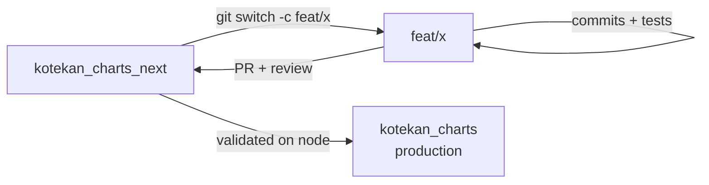
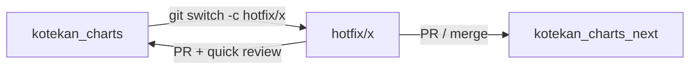
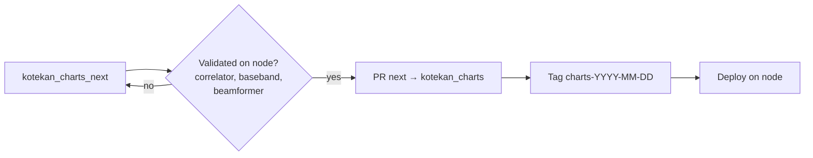
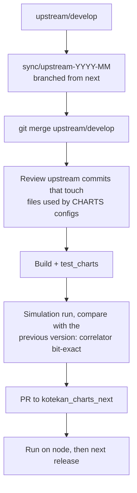
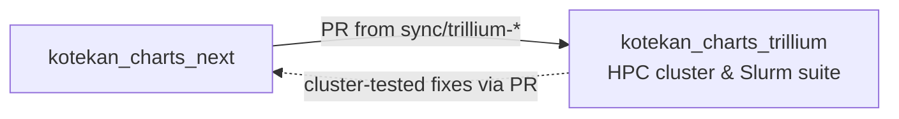

# Contributing to kotekan (CHARTS)

How to add features or fixes to the CHARTS fork of kotekan without breaking production, how
releases reach the node, and how upstream (CHIME/CHORD) changes are brought in.

## TL;DR

1. Branch from `kotekan_charts_next`: `feat/<short-name>` or `fix/<short-name>`.
2. Small, focused commits. Build and run the relevant tests.
3. Open a PR to `kotekan_charts_next`. Get at least one review.
4. Never push directly to `kotekan_charts` or `kotekan_charts_next`.



## 1. Branches

| Branch | Meaning | Can I push? |
|---|---|---|
| `kotekan_charts` | Production, runs on the node | No, PR from `next` only (release) |
| `kotekan_charts_next` | Integration | No, PR only |
| `kotekan_charts_trillium` | Trillium HPC cluster testing & validation | No, PR only (syncs from `next` via `sync/trillium-*`) |
| `feat/*`, `fix/*` | Your work | Yes, it is yours |
| `hotfix/*` | Urgent production fix, branched from `kotekan_charts` | Yes, then PR to both |
| `sync/upstream-*`, `sync/trillium-*` | Upstream merge / Trillium sync | Whoever runs the sync |

Rules:
- Every change reaches `kotekan_charts`, `kotekan_charts_next` and `kotekan_charts_trillium` through a PR with at least one review (branch protection).
- Use merge, not rebase, on shared branches. Never force-push a published branch.
- Delete feature branches after they are merged.
- `kotekan_charts_trillium` must always remain in sync with or ahead of `kotekan_charts_next`.

## 2. Step by step

```bash
git fetch origin
git switch -c feat/my-feature origin/kotekan_charts_next

# ... edit, build, test ...
git add lib/cuda/myCommand.cpp lib/cuda/myCommand.hpp   # explicit paths, never `git add .`
git commit -m "feat(cuda): add myCommand for X"

# keep up to date with next while working (merge, do not rebase a pushed branch)
git fetch origin && git merge origin/kotekan_charts_next

git push -u origin feat/my-feature
gh pr create --base kotekan_charts_next
```

### Commit messages
`type(scope): summary`, in English. Types: `feat`, `fix`, `docs`, `test`, `chore`, `refactor`.
Examples: `feat(cuda): add cudaVisibilityCalibrator`, `fix(dpdk): align port startup`.

### Before opening a PR
- [ ] It builds: `cmake -DUSE_CUDA=ON -DUSE_DPDK=ON -DUSE_NUMA=ON .. && make -j kotekan`
- [ ] Relevant tests pass: `python -m pytest test_charts/tests/<file>.py -q`
- [ ] If you touched the data path (capture, shuffle, correlator, accumulation): a simulation run gives the same output as before, or you explain why it changes.
- [ ] No data, gains or personal files committed.
- [ ] The PR description says **what changed, why, and how it was tested** (simulation, node, which config).

## 3. Files that need extra care

Changes here can break data taking or silently corrupt data. PRs that touch them need review
from someone who knows that part, and a test on the node before release.

| Area | Files | Why it is sensitive |
|---|---|---|
| Packet capture | `lib/dpdk/dpdkCore.*`, `lib/dpdk/rfsocHandler*.hpp`, `lib/dpdk/zeroSamples.cpp` | Lost packets, misaligned ports or wrong channel order break every product downstream. Cannot be fully tested in simulation. |
| GPU framework | `lib/cuda/cudaCommand.*`, `cudaProcess.*`, `cudaSync*`, `cudaDeviceInterface.*` | Base class of every CHARTS GPU command. An API change breaks all of them. |
| Correlator path | `lib/cuda/cudaShuffleAstron.*`, `cudaCorrelatorAstron.*`, `cudaVisibilityCalibrator.*`, `lib/stages/chartsAccumulate.*` | Output must stay bit-exact. Frame layout `[freq][baseline 528][pol][pol][re,im]` int32 is assumed by charts-utils. |
| Constants | `lib/core/chartsConstants.hpp` | Mirror of `charts-constants`. Change both together; a parity test checks them. |
| Metadata | `lib/metadata/chartsMetadata.*` | Timestamps and frequency info used by analysis. Format changes break readers in charts-utils. |
| Baseband | `lib/stages/chartsBasebandReadout*`, `chartsTriggeredBasebandReadout*`, `chartsBaseband*Select*` | Raw file format read by `convert_baseband_raw2h5.py` and `BasebandReader`. |
| Production configs | `charts/config/64antennas_corr*.yaml`, `64antennas_direct_tracker*.yaml`, `64antennas_record.yaml` | What the node actually runs. |

### Conventions you must not break
- **Antenna indexing:** kotekan raw element `r = N-1-a` for CHARTS antenna `a`. Raw element `r` = receiver `r//2`, pol `r%2`.
- **Visibility convention:** `V_ab = x_a · conj(x_b)`, lower triangle, baseline index `a(a+1)/2 + b` with `a >= b`.
- **Frequency shards:** 672 channels split into 2 × 336 (`freq_offset` / `coarse_freq_start` = 0 and 336).
- **Voltages:** 4+4 bit complex. Correlator output int32, accumulated in int64.

If your change alters any of these, it also needs a matching change in charts-utils and a note in the PR.

## 4. Hotfixes (production is broken)



Fix the minimum needed, test on the node, merge into `kotekan_charts`, and merge the same fix into
`kotekan_charts_next` right away, so the next release does not undo it.

## 5. Releases to production



- Run each production config on the node before the release PR (no lost packets or frames, both frequency shards aligned, fringes consistent with the previous release) and put the results in the PR. `charts/ci/node_smoke_test.sh` does this and writes the `summary.md` to attach; see [ci/node_smoke_test.md](ci/node_smoke_test.md).
- **Tag every release** (`git tag charts-YYYY-MM-DD`). Analysis must be able to tell which kotekan version produced a dataset; record the tag in the observation log.

## 6. Bringing in upstream changes

Most of the repository is upstream CHIME/CHORD code that CHARTS does not run. Upstream is merged
into `kotekan_charts_next` (never directly into production) through a `sync/upstream-YYYY-MM` branch.



```bash
git fetch upstream
git switch -c sync/upstream-2026-11 origin/kotekan_charts_next
git merge upstream/develop
# what changed upstream in the areas CHARTS depends on:
git log --oneline origin/kotekan_charts_next..upstream/develop -- lib/dpdk lib/cuda/cudaCommand* \
    lib/cuda/cudaProcess* lib/cuda/cudaSync* lib/core lib/metadata CMakeLists.txt cmake
```

On every sync, check the areas in §3 first, plus any stage renamed or removed upstream that a
`charts/config/*.yaml` still uses. Cadence: monthly, or when upstream has something we need; longer
gaps make merges harder.

Avoid editing upstream files for CHARTS needs: prefer a new `charts*` stage or `cuda*` command.
Every edit to an upstream file is a potential conflict at the next sync. If you must edit one, keep
the change minimal and say so in the PR.

## 7. Trillium cluster testing (`kotekan_charts_trillium`)

The `kotekan_charts_trillium` branch is dedicated to running large-scale simulation campaigns,
benchmarks, and verification on the Trillium HPC cluster.



### Invariants and differences from `next`
- **Always in sync or ahead of `kotekan_charts_next`**: Any update or merge into `kotekan_charts_next` should be merged promptly into `kotekan_charts_trillium`. It must never lag behind `next`.
- **Slurm testing scripts**: Houses all Slurm batch launchers under `test_charts/slurm/` (e.g. `submit_10tb_correlator_campaign.slurm`, `submit_build_and_test.slurm`, `submit_direct_beam_tracker_benchmark.slurm`, `trillium_pipeline.slurm`, and `submit_sequential.sh`). These scripts exist only on this branch to keep `next` minimal.
- **Cluster build adaptations**: Configured and adapted to compile within Trillium's environment (cluster modules, toolchains, and dynamic CUDA compute capabilities targeting the host cluster GPUs rather than hardcoded architectures).

### Keeping `kotekan_charts_trillium` in sync
When `kotekan_charts_next` moves forward (new features merged, upstream syncs), update the Trillium
branch through a PR, like any other shared branch:

```bash
git fetch origin
git switch -c sync/trillium-YYYY-MM-DD origin/kotekan_charts_trillium
git merge origin/kotekan_charts_next
# verify build and test configs
git push -u origin sync/trillium-YYYY-MM-DD
gh pr create --base kotekan_charts_trillium
```

If a bug fix or pipeline improvement is developed while running cluster jobs on Trillium, open a PR targeting `kotekan_charts_next` first (or cherry-pick/merge it into `next`) so changes flow back to integration and production.
