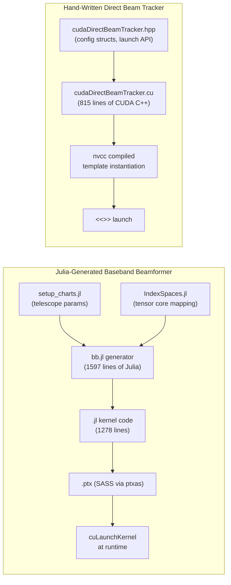

# Julia Auto-Generated Baseband Beamformer vs CHARTS Direct Beam Tracker

## Overview

These are two fundamentally different beamformers targeting different purposes, built with radically different engineering approaches. Both live in the CHARTS fork of kotekan and run on the same GPU hardware, but they solve different problems at different levels of the pipeline.

---

## What Each Kernel Does

### Julia-Generated `BasebandBeamformer_charts`
- **Output**: Complex **baseband voltages** (4+4-bit integer, `Int4x8`)
- **Purpose**: Coherent beamforming → preserves phase information for downstream processing (e.g. pulsar timing, VLBI, transient search pipelines)
- **Inputs**: `E` (voltage data, `Int4x2`), `A` (phase matrix, `Int8`), `s` (shift parameters, `Int32`)
- **Source**: [BasebandBeamformer_charts.jl](file:///d:/charts/kotekan/lib/cuda/generated/BasebandBeamformer_charts.jl) — generated by [bb.jl](file:///d:/charts/kotekan/julia/kernels/bb.jl) via [bb_charts.jl](file:///d:/charts/kotekan/julia/kernels/bb_charts.jl)
- **C++ wrapper**: [cudaBasebandBeamformer_charts.cpp](file:///d:/charts/kotekan/lib/cuda/generated/cudaBasebandBeamformer_charts.cpp)

### Hand-Written `cudaDirectBeamTracker`
- **Output**: Complex **float32 voltages** (`float2`) per beam per polarization
- **Purpose**: Direct beamforming with real-time celestial tracking, subframe interpolation, sky grid scanning — a versatile tracking beamformer
- **Inputs**: Packed `int4x2` voltages, precomputed `float2` steering weights (with optional step weights for source tracking interpolation)
- **Source**: [cudaDirectBeamTracker.cu](file:///d:/charts/kotekan/lib/cuda/cudaDirectBeamTracker.cu), [cudaDirectBeamTracker.hpp](file:///d:/charts/kotekan/lib/cuda/cudaDirectBeamTracker.hpp)

---

## Architecture Comparison



---

## Key Technical Differences

| Aspect | Julia Baseband Beamformer | Direct Beam Tracker |
|---|---|---|
| **Compute core** | **Tensor Cores** (`mma.m8n8k16.s8`) | **FP32 CUDA cores** (`fmaf`) |
| **Data precision** | Int8 × Int4 → Int32 (integer pipeline) | Int4 → float32 (FP pipeline) |
| **Output type** | 4+4-bit complex integer | 32-bit complex float |
| **Phase model** | Pre-baked `Int8` phase matrix (A) | `float2` steering weights with optional step-rotation |
| **Source tracking** | Handled externally (new A matrix each lifetime) | Built-in subframe interpolation via `complex_pow_int` rotation |
| **Calibration** | Baked into the phase matrix | Applied in weight generation kernel separately |
| **Thread config** | 32×4 = 128 threads, 336 blocks, 8 blocks/SM | 32×4 = 128 threads, dynamic grid, templated dispatch |
| **Shared memory** | 9472 bytes (voltage tile + reduction scratch) | Optional cooperative smem for voltage reuse across warps |
| **Warp reduction** | `shfl_xor_sync` for register swizzling | `shfl_down_sync` tree reduction |
| **Beam tiling** | 8 beams per MMA (register-level) | Configurable B_TILE (1, 2, or 4 beams per warp) |
| **CHARTS design params** | D=64, B=16, F=336, T=65536 | Any power-of-2 elements (32–512), dynamic beam count |
| **PTX target** | `sm_86` PTX, compiled for `sm_120` at runtime | Native nvcc compilation for local arch |

---

## Optimization Strategies

### Julia Baseband Beamformer — Tensor-Core-Centric

The key insight of this kernel is that beamforming $J = A \cdot E$ is a **matrix multiply** and can be mapped onto Tensor Cores:

1. **`mma_m8n8k16_s8`**: Uses the integer 8×8×16 Tensor Core MMA instruction. The multiply is A (8-bit phase × beam) × E (4-bit voltage × time) → J (32-bit accumulator). This gives massive throughput: one MMA replaces hundreds of FP32 `fmaf`s.

2. **Fully unrolled dish loop**: The generator unrolls the dish dimension (`D=64`) into groups of 16 (the MMA `k` dimension), producing 4 unrolled iterations with all addresses pre-computed.

3. **Symbolic index algebra**: The `IndexSpaces.jl` package computes all memory offsets symbolically at generation time. What looks like incomprehensible nested `imod`/`idiv` expressions are actually compile-time-constant address calculations — no runtime arithmetic.

4. **Register-level data movement**: Uses `shfl_xor_sync`, `get_lo16`/`get_hi16`, `get_lo8`/`get_hi8` to swizzle data between threads without touching shared memory — matching the Tensor Core's required data layout.

5. **Voltage ring buffer wrapping**: The `E` input is a ring buffer; the kernel uses `mod(offset, length)` to wrap time indices, allowing continuous streaming without copies.

6. **Two-stage accumulation with shift-and-clamp**: To avoid integer overflow while keeping intermediates in 16-bit registers:
   - Stage 1: Accumulate dish groups via MMA, then right-shift by $\sigma = \log_2(D / W_d) - 4$. For CHARTS ($D=64, W_d=1$): $\sigma = 2$. Store 16-bit intermediates in shared memory (`Ju_shared`).
   - Stage 2: Reduce across remaining dish warps, shift by $s_1 = s - \sigma$, clamp to $[-7, +7]$. If any thread overflows, the block writes a flag to `gpu_mem_log`.

7. **PTX compatibility trick**: Julia/LLVM 18 can only emit PTX up to `sm_90`, but CHARTS targets RTX 5090 (`sm_120`). The generator emits `.target sm_86` PTX, then the C++ wrapper passes `--gpu-name=sm_120` to `ptxas` at Kotekan startup, producing native Blackwell SASS at runtime.

> [!IMPORTANT]
> The Julia kernel is specialized for the exact CHARTS array: D=64 dishes, B=16 beams, F=336 frequencies. Changing any of these requires re-running the Julia generator. It cannot adapt at runtime.

### Direct Beam Tracker — FP32 + Template Metaprogramming

1. **C++ template dispatch**: A chain of lambdas (`dispatch_pol → dispatch_b_tile → dispatch_interp → dispatch_smem`) selects the right kernel instantiation from ~50+ compiled variants at runtime via `switch(n_elem)`.

2. **Vectorized loads**: `load_and_unpack_contiguous<ELEM_PER_LANE>` uses `uint4` (128-bit) loads to fetch 16 elements at once, then unpacks with PTX `bfe.s32` for 4-bit extraction.

3. **Multi-beam register tiling**: Each warp accumulates `B_TILE` beams simultaneously (up to 4), with weights and accumulators held in registers. This means one voltage load serves multiple beams.

4. **Subframe interpolation**: Step weights rotate the steering vector on every time sample via `complex_mul(w, dw)` — tracking a moving source within a single kernel invocation without recomputing weights.

5. **L2 cache persistence**: `set_l2_persisting_weights_policy()` pins steering weights in L2 cache, reducing global memory pressure on the hot path.

6. **Cooperative shared memory**: When beam count is large (`≥ 2 × B_TILE`) and element count high (`≥ 128`), the kernel switches to a mode where all 4 warps cooperatively load voltage data into shared memory, then each warp processes its own beam tile — a 4× reduction in global memory loads.

7. **Time unrolling**: Processes 4 or 8 time samples per inner loop iteration, amortizing weight loads and enabling instruction-level parallelism.

> [!TIP]
> The Direct Beam Tracker's runtime flexibility (arbitrary beam count, dynamic antenna masking, real-time RA/Dec tracking with `compute_celestial_direction`) makes it ideal for CHARTS operations where the telescope configuration changes frequently.

---

## Code Style and Maintainability

### Julia Generator (`bb.jl`)
- **1597 lines of Julia** generate **1278 lines of kernel code** + PTX + YAML + C++ wrapper
- The generated `.jl` kernel is **effectively unreadable** by humans — it's a flat sequence of symbolically-computed index expressions
- Changes require understanding the `IndexSpaces.jl` framework, Julia metaprogramming, and Tensor Core data layout
- The generator itself is well-structured: loop definitions, index mappings, and MMA calls are cleanly separated
- Tested on the upstream CHORD project with known performance baselines
- The C++ wrapper ([cudaBasebandBeamformer_charts.cpp](file:///d:/charts/kotekan/lib/cuda/generated/cudaBasebandBeamformer_charts.cpp)) is also auto-generated and handles ring buffer management, metadata validation, and PTX loading

### Direct Beam Tracker
- **815 lines of readable CUDA C++** with clear function decomposition
- Uses standard CUDA idioms: templated kernels, `__launch_bounds__`, `#pragma unroll`, `fmaf`
- Directly editable and debuggable with standard GPU tooling (nsight, cuda-gdb)
- Flexible runtime dispatch via template metaprogramming — one source handles all array sizes

---

## Performance Profile

| Metric | Julia Baseband | Direct Beam Tracker |
|---|---|---|
| **Compute unit** | Tensor Cores (int8 MMA) | FP32 CUDA cores |
| **Theoretical throughput** | ~312 TOPS (sm_120 int8) | ~83 TFLOPS (sm_120 FP32) |
| **Arithmetic intensity** | Very high (MMA batches 16 MADs) | Moderate (scalar fmaf) |
| **Memory access pattern** | Cooperative loads + shared mem staging | Per-warp loads or cooperative smem |
| **Output precision** | 4-bit (lossy quantization) | 32-bit float (full precision) |
| **Bandwidth bound?** | Likely compute-bound (MMA-limited) | Likely memory-bound (weight loads) |
| **Latency hiding** | Register swizzling across warps | Time unrolling + vectorized loads |

> [!NOTE]
> These are not directly comparable as benchmarks because they compute different things. The Julia kernel outputs quantized integer voltages suitable for further GPU processing, while the Direct Beam Tracker outputs full-precision float voltages suitable for immediate analysis or recording.

---

## When to Use Which

| Scenario | Recommended |
|---|---|
| High-throughput coherent beamforming in a fixed pipeline | Julia Baseband Beamformer |
| Real-time source tracking with interpolation | Direct Beam Tracker |
| Pulsar timing / VLBI (need baseband output) | Julia Baseband Beamformer |
| Transient search with dynamic beam pointing | Direct Beam Tracker |
| Variable array configuration (testing, commissioning) | Direct Beam Tracker |
| Maximum throughput with known fixed parameters | Julia Baseband Beamformer |
| Sky grid scanning / all-sky monitoring | Direct Beam Tracker |

---

## Summary

The Julia-generated baseband beamformer is an **algebraic code generator** that treats beamforming as a matrix multiply and maps it onto Tensor Cores. It's maximally optimized for a fixed set of telescope parameters but produces opaque, non-editable kernel code. It outputs quantized integers for downstream GPU processing.

The Direct Beam Tracker is a **hand-written, flexible CUDA kernel** using FP32 cores with runtime template dispatch. It supports real-time source tracking, dynamic beam configuration, and produces full-precision float output. It trades peak throughput for operational flexibility.

They serve complementary roles: the Julia kernel for the steady-state high-throughput pipeline, and the Direct Beam Tracker for the agile, operationally-driven use cases that CHARTS needs day-to-day.

---

## Other CHARTS Auto-Generated Kernels

The baseband beamformer isn't the only Julia-generated kernel for CHARTS. The `lib/cuda/generated/` directory also contains:

| Kernel | Generator | Purpose |
|---|---|---|
| [`cudaFRBBeamformer_charts_U32`](file:///d:/charts/kotekan/lib/cuda/generated/cudaFRBBeamformer_charts_U32.cpp) | [`frb.jl`](file:///d:/charts/kotekan/julia/kernels/frb.jl) | FRB search beamformer — 256 beams, 10752 fine channels, Float16 intensity output |
| [`cudaUpchannelizer_charts_U32_K4`](file:///d:/charts/kotekan/lib/cuda/generated/cudaUpchannelizer_charts_U32_K4.cpp) | `upchan.jl` | Polyphase filter bank — 336→10752 channels (U=32, K=4 taps), 512 threads, 33920 bytes smem |

All are generated by the same [Julia toolchain](file:///d:/charts/kotekan/julia/kernels) using `IndexSpaces.jl` + `CUDASIMDTypes.jl` + Mustache templates, driven by [`make_kernels.sh`](file:///d:/charts/kotekan/julia/bin/make_kernels.sh). The generation pipeline is:

```
setup_charts.jl (telescope params) + bb.jl (algorithm DSL)
    → Julia/CUDA.jl compilation
    → .jl (kernel source) + .ptx (PTX assembly) + .yaml (metadata)
    → bb_template.cxx (Mustache) → .cpp (C++ cudaCommand wrapper)
```

A [reference CPU implementation](file:///d:/charts/kotekan/julia/cxx/bb.cxx) and a [GPU simulation stage](file:///d:/charts/kotekan/lib/testing/gpuSimulateCudaBasebandBeamformer.hpp) exist for bitwise verification.
