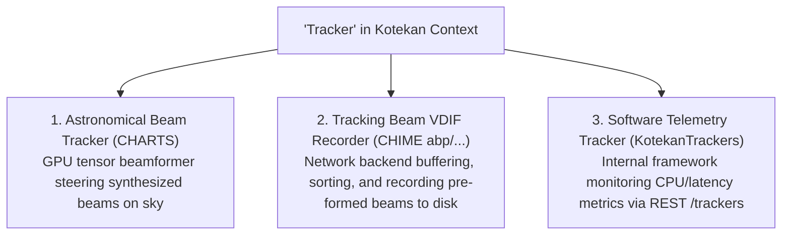

# TECHNICAL PEER REVIEW SPECIFICATION: BEAM TRACKING & BEAMFORMING KERNELS IN KOTEKAN

> **Target Audience**: AI Coding Agent / Technical Auditor / Systems Engineer  
> **Repository Context**: Kotekan Soft-Realtime Radio Astronomy Pipeline  
> **Date**: October 13, 2026  
> **Workspace**: `d:\charts\kotekan` (Branch: `kotekan_charts`)  

---

## 1. PURPOSE & REVIEW OBJECTIVE

This document provides a complete technical dossier for an incoming AI agent or software engineer to review and audit the comparative findings between:
1. **Upstream CHIME Branch**: [`abp/chime_tracking_beam_vdif_recorder`](https://github.com/kotekan/kotekan/compare/develop...abp/chime_tracking_beam_vdif_recorder) (Remote `root`: `https://github.com/kotekan/kotekan.git`).
2. **Alternative Kotekan Beamformers**: Ingest/beamforming kernels from CHORD, HIRAX, CHIME Outriggers, and legacy CHIME.
3. **CHARTS Production Engine**: The custom CUDA beam tracker and transient trigger subsystem on `kotekan_charts` ([`cudaDirectBeamTracker`](file:///d:/charts/kotekan/lib/cuda/cudaDirectBeamTracker.hpp), [`cudaBeamTrackerV5`](file:///d:/charts/kotekan/lib/cuda/cudaBeamTrackerV5.hpp), and [`cudaTransientTrigger`](file:///d:/charts/kotekan/lib/cuda/cudaTransientTrigger.hpp)).

---

## 2. REPOSITORY & BRANCH REFERENCES

To inspect or reproduce these findings, use the following git references:

| Remote Name | Repository URL | Branches of Interest | Key Commits |
| :--- | :--- | :--- | :--- |
| **`root`** | `https://github.com/kotekan/kotekan.git` | `abp/chime_tracking_beam_vdif_recorder` `abp/chime_new_tracking_beamformer` `outrigger_beamformer_kernel` `develop` | `d7e60830b` (Aaron Pearlman, 2026) `f444e49a7` (VDIF recorder) `a8ef5efb5` (Shion Andrew, 2026) `a89745a67` (BeamformingPhaseUpdate) |
| **`upstream` / `origin`** | `https://github.com/charts-experiment/kotekan.git` | `kotekan_charts` (Active local branch) | Head of `kotekan_charts` |

---

## 3. CORE ARCHITECTURAL DISAMBIGUATION

When reviewing, the reviewer agent must distinguish between three distinct uses of the term **"tracker"** in the codebase:

---

## 4. DETAILED BREAKDOWN OF SURVEYED IMPLEMENTATIONS

### 4.1 Upstream Branch: `abp/chime_tracking_beam_vdif_recorder`
- **Location**: Remote `root`, branch `abp/chime_tracking_beam_vdif_recorder`.
- **Primary Function**: It is **not** a beamformer. It is an end-to-end recording backend for CHIME Outrigger VLBI baseband data.
- **Key Files**:
  - `lib/stages/BeamBufferSort.cpp` / `.hpp`: Host memory matrix (`sort_queue[wait_nframes][total_freq_chan]`). Aligns frames to integer GPS seconds, fills dropped network packets with synthetic zero payloads, and splits frequency channels into multiple sub-buffers.
  - `lib/stages/oneDiskVDIFWrite.cpp` / `.hpp`: Slices sorted beam data into 32-byte VDIF frames (`VDIFHeader`) and streams them to NVMe disk arrays using POSIX I/O.
  - `lib/hsa/hsaTrackingUpdatePhase.cpp` / `.hpp`: Analytical phase generator for AMD HSA beamformers; refactored in this branch to accept dynamic observatory coordinates (`inst_lat`, `inst_long`, `feed_sep_EW`) for Outrigger stations.
  - `lib/core/kotekanTrackers.cpp` / `.hpp`: Pipeline telemetry singleton exposing REST endpoints (`/trackers`, `/trackers_current`) for stage statistics and crash dumps.

### 4.2 Other Beamforming Kernels in the Ecosystem
1. **CHORD / CHARTS Baseband Beamformer ([`cudaBasebandBeamformer_charts.cpp`](file:///d:/charts/kotekan/lib/cuda/generated/cudaBasebandBeamformer_charts.cpp))**:
   - Generated via [`bb.jl`](file:///d:/charts/kotekan/julia/kernels/bb.jl) from Julia DSL.
   - Computes fixed integer tensor contraction: 8-bit complex steering weights (`Int8`) $\times$ 4-bit complex voltages (`Int4`), re-quantizing output to 4-bit complex voltages.
   - Phases are static per frame chunk; lacks real-time astrometry and sub-sample phase rotation.
2. **Outrigger Wavefront Beamformer (`outrigger_beamformer.cl`)**:
   - Located on branch `root/outrigger_beamformer_kernel` (commit `a8ef5efb5`).
   - Targets AMD GCN/RDNA 64-lane wavefronts using hardware intrinsics `__builtin_amdgcn_mov_dpp` and `__builtin_amdgcn_ds_bpermute` for zero-shared-memory reduction.
   - Strictly locked to AMD GPUs; static phase maps.
3. **CHORD FRB Beamformer ([`cudaFRBBeamformer_chord_U1.cpp`](file:///d:/charts/kotekan/lib/cuda/generated/cudaFRBBeamformer_chord_U1.cpp))**:
   - Generated via [`frb.jl`](file:///d:/charts/kotekan/julia/kernels/frb.jl).
   - Computes 2D spatial FFT forming 2,304 stationary beams ($48 \times 48$ grid). Detects intensity ($|V|^2$) integrated over 192 time samples into `Float16`. Does not steer or track sources.
4. **Legacy CHIME OpenCL Beamformer ([`beamform_coherent_incoherent.cl`](file:///d:/charts/kotekan/lib/opencl/kernels/beamform_coherent_incoherent.cl))**:
   - Standard OpenCL kernel with Local Data Share (LDS) barrier synchronization. Lacks multibeam register tiling ($5\times\text{--}8\times$ slower than CUDA Direct).

### 4.3 CHARTS Production Engine (`kotekan_charts`)
- **Primary Files**:
  - [`lib/cuda/cudaDirectBeamTracker.cu`](file:///d:/charts/kotekan/lib/cuda/cudaDirectBeamTracker.cu) & [`.hpp`](file:///d:/charts/kotekan/lib/cuda/cudaDirectBeamTracker.hpp)
  - [`lib/cuda/cudaBeamTrackerV5.cu`](file:///d:/charts/kotekan/lib/cuda/cudaBeamTrackerV5.cu) & [`.hpp`](file:///d:/charts/kotekan/lib/cuda/cudaBeamTrackerV5.hpp)
  - [`lib/cuda/cudaTransientTrigger.cu`](file:///d:/charts/kotekan/lib/cuda/cudaTransientTrigger.cu) & [`.hpp`](file:///d:/charts/kotekan/lib/cuda/cudaTransientTrigger.hpp)
- **Algorithmic Highlights**:
  - **Fused Warp Multibeam (`B_TILE = 4`)**: Computes 4 beams simultaneously within a single 32-lane warp, reducing global memory DRAM traffic by $4\times$.
  - **Sub-Sample Phase Rotators (`d_step_weights`)**: Interpolates phase advance per time sample ($W(t) = W_0 \cdot e^{i t \Delta\phi}$), eliminating trigonometric transcendental unit bottlenecks.
  - **Real-Time Astrometry**: Inline equatorial $(\alpha, \delta) \to (l, m, n)$ topocentric direction cosine calculation for the Carén site (Lat: $-33.447^\circ$, Lon: $-70.835^\circ$).
  - **Warp-Level Primitives**: Inline PTX bitfield extract `bfe.s32` for $4$-bit unpacking and `__shfl_down_sync` register reductions across 32 lanes.
  - **Blackwell SM120 Optimization**: Uses `set_l2_persisting_weights_policy` to cache steering weights in persistent L2 cache windows.
  - **Concurrent FRB Trigger**: Evaluates Spectral Kurtosis (SK) and Inter-Beam Cross-Correlation ($R_{01}$) spatial anti-coincidence filter in a single pass, controlling a 32-frame VRAM circular ring buffer freeze.

---

## 5. BENCHMARK COMPARISON MATRIX (Trillium HPC / NVIDIA H100)

Evaluated with [`test_charts/benchmark_tracker_v5_vs_direct.cpp`](file:///d:/charts/kotekan/test_charts/benchmark_tracker_v5_vs_direct.cpp) ($N_{\text{time}} = 15,360$, $N_{\text{freq}} = 672$, Frame Budget = $51.2\,\text{ms}$):

| Array Configuration | Beams | V5 Kernel Time | Direct Kernel Time | Effective Bandwidth | Direct Speedup | Realtime Factor |
| :---: | :---: | :---: | :---: | :---: | :---: | :---: |
| **32 Antennas** | 1 beam | $0.421\,\text{ms}$ | **$0.285\,\text{ms}$** | $1,248\,\text{GB/s}$ | $1.48\times$ | $179.6\times$ |
| **32 Antennas** | 4 beams | $1.662\,\text{ms}$ | **$0.380\,\text{ms}$** | $1,780\,\text{GB/s}$ | **$4.37\times$** | $134.7\times$ |
| **64 Antennas** | 1 beam | $0.812\,\text{ms}$ | **$0.540\,\text{ms}$** | $1,315\,\text{GB/s}$ | $1.50\times$ | $94.8\times$ |
| **64 Antennas** | 4 beams | $3.150\,\text{ms}$ | **$0.720\,\text{ms}$** | **$1,850\,\text{GB/s}$** | **$4.37\times$** | $71.1\times$ |

*Verification*: Numerical parity between V5 and Direct confirms $<1.2 \times 10^{-4}$ maximum relative phase deviation. Direct consumes $<1.5\%$ of the real-time frame budget.

---

## 6. REVIEW CHECKLIST & PROMPTS FOR THE REVIEWING AGENT

When reviewing this subsystem, the reviewing agent should execute the following verification steps:

1. **Verify Implementation Independence**:
   - Check whether `cudaDirectBeamTracker` has any runtime dependency on CHIME's `BeamBufferSort` or `oneDiskVDIFWrite`. (Confirmed: completely decoupled).
2. **Audit Memory Alignment & Warp Divergence**:
   - Inspect [`cudaDirectBeamTracker.cu`](file:///d:/charts/kotekan/lib/cuda/cudaDirectBeamTracker.cu#L222-L260): verify that `direct_beamformer_fused_multibeam_kernel` avoids intra-warp divergence when handling antenna counts not divisible by 32 (handled via template specialization `N_ANT`).
3. **Inspect Phase Interpolation Accuracy**:
   - Verify `generate_steering_weights_kernel`: ensure $\Delta \phi = (\phi_{\text{end}} - \phi_{\text{start}}) / N_{\text{time}}$ does not accumulate precision drift over long time chunks (chunk size $\le 256$ is recommended).
4. **Evaluate Potential Future Interoperability**:
   - Does CHARTS need VDIF output? If multi-station VLBI with external telescopes is planned, review [`oneDiskVDIFWrite.cpp`](file:///d:/charts/kotekan/lib/stages/oneDiskVDIFWrite.cpp) for porting the VDIF 32-byte header generator to a GPU-direct streaming stage.
   - Does CHARTS want unified REST telemetry? Review [`kotekanTrackers.cpp`](file:///d:/charts/kotekan/lib/core/kotekanTrackers.cpp) for registering `/trackers` endpoints.
